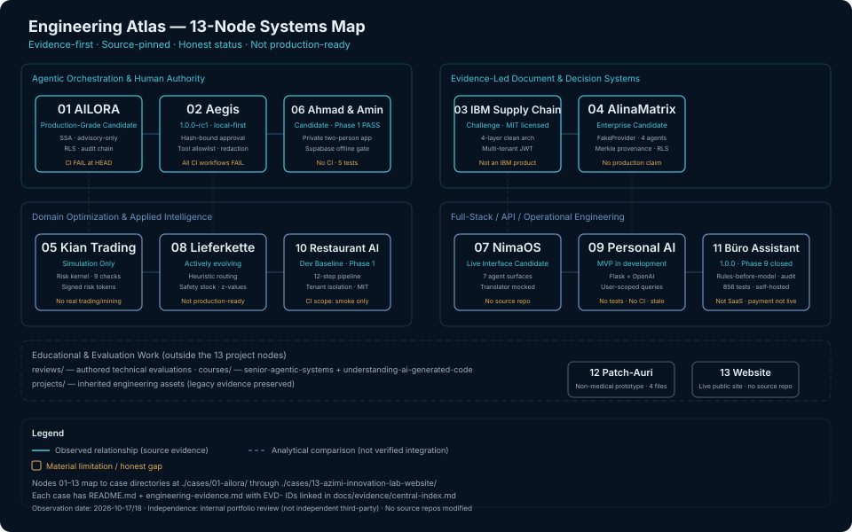

# Amin Azimi

**AI Systems Architect | End-to-End Systems Development**

**Azimi Innovation Lab**

> **Integrity is a person’s greatest asset. Humanity is not defined by a job title, professional status, or position of authority. These are not merely principles I advocate; they are values I strive to live by.**

[azimi-innovation-lab-website.vercel.app](https://azimi-innovation-lab-website.vercel.app/) · [LinkedIn](https://www.linkedin.com/in/amin-azimi-b010)

---

## How to Review This Portfolio

This is an evidence-first engineering portfolio. Every claim traces to source code, a pinned SHA, or an explicit "Not independently verified" statement. No system is described as production-ready unless implementation, tests, deployment, security, and operational evidence all exist.

**Navigation path (any of 13 cases in 2 clicks):**
1. Scan the [Systems Map](#engineering-atlas) below or the [case table](#all-13-systems).
2. Follow a case link to `./cases/<NN>/README.md` and `./cases/<NN>/engineering-evidence.md`.
3. Cross-reference evidence IDs (`EVD-NN-NNN`) in [`docs/evidence/central-index.md`](./docs/evidence/central-index.md).

**Evidence layers:** [`docs/evidence/`](./docs/evidence/) — claims, source inventory, verification status, source traceability notes, provenance rules. [`docs/engineering/`](./docs/engineering/) — cross-project architecture and engineering synthesis (Phase 8). [`cases/`](./cases/) — per-project engineering evidence with architecture, decisions, and gaps. [`reviews/`](./reviews/) and [`courses/`](./courses/) — authored technical evaluations and teaching materials (outside the 13 project nodes).

**Independence:** Source/documentation observations only; no independent reproduction claimed.

**Observation date:** 2026-10-17/18. Source SHAs pinned in [`docs/evidence/source-inventory.csv`](./docs/evidence/source-inventory.csv).

---

## Engineering Atlas



The atlas above maps 13 systems into four capability categories. Solid lines represent observed relationships (shared patterns confirmed in source). Dashed lines represent analytical comparisons — not verified integrations. Amber text marks material limitations and honest gaps. Each node links to its case directory in the table below.

**Design tokens:** Deep navy `#071321` · Muted cyan `#48C7D9` · Steel blue `#7093C3` · Off-white `#E8F0F5` · Cool slate `#9DAFBE` · Amber `#E3AD57`.

---

## All 13 Systems

| # | System | Case | Status | Source | Evidence |
|---|--------|------|--------|--------|----------|
| 01 | [AILORA](./cases/01-ailora/) | [case](./cases/01-ailora/engineering-evidence.md) | Production-Grade Candidate · Active Qualification · Not Production-Ready | [GitHub](https://github.com/azimilab2025-ai/ailora) `46ca4a9` | R2 · CI FAIL at HEAD |
| 02 | [Aegis Agent](./cases/02-aegis-agent/) | [case](./cases/02-aegis-agent/engineering-evidence.md) | 1.0.0-rc1 · local-first · human approval gate | [GitHub](https://github.com/aminazimi42-coder/aegis-agent) `69f1597` | R1 · All CI FAIL |
| 03 | [IBM Supply Chain](./cases/03-supply-chain-challenge-ibm-2026/) | [case](./cases/03-supply-chain-challenge-ibm-2026/engineering-evidence.md) | IBM TechXchange 2026 Challenge · live verified · not an IBM product | [GitHub](https://github.com/azimilab2025-ai/IBM-Bob-Challenge-2026) `d00c5eb` | R1 · No CI · MIT |
| 04 | [AlinaMatrix Enterprise](./cases/04-alina-matrix-enterprise/) | [case](./cases/04-alina-matrix-enterprise/engineering-evidence.md) | Enterprise Candidate — Active Development · No production claim · DeterministicFakeProvider only | [GitHub](https://github.com/aminbita162-glitch/AlinaMatrix-Enterprise) `e7cc7df` | R1 · CI PASS |
| 05 | [Kian Trading Intelligence](./cases/05-kian-trading-intelligence/) | [case](./cases/05-kian-trading-intelligence/engineering-evidence.md) | Simulation Only — LIVE not authorized · No real trading · No real mining | [GitHub](https://github.com/aminbita162-glitch/kian-trading-intelligence) `54ef6ca` | R1 · CI PASS |
| 06 | [Ahmad & Amin Technology](./cases/06-ahmad-amin-technology/) | [case](./cases/06-ahmad-amin-technology/engineering-evidence.md) | Candidate · Phase 1 PASS · Private two-person app · Supabase sync not live | [GitHub](https://github.com/aminbita162-glitch/ahmad-amin-technology) `fbbfc30` | R1 · No CI |
| 07 | [NimaOS AI Agent](./cases/07-nimaos-ai-agent/) | [case](./cases/07-nimaos-ai-agent/engineering-evidence.md) | Live Interface Candidate · Model Mock · Translator Mocked · Ollama Not Connected | [Vercel](https://nimaos-ai-agent.vercel.app/translator) | R0 · No source repo |
| 08 | [Lieferkette Optimierungsplattform](./cases/08-lieferkette-optimierungsplattform/) | [case](./cases/08-lieferkette-optimierungsplattform/engineering-evidence.md) | Actively evolving · Not Production-Ready | [GitHub](https://github.com/aminbita162-glitch/lieferkette-optimierungsplattform) `91c6121` | R1 · CI PASS · 1 test file |
| 09 | [Personal AI Assistant](./cases/09-personal-ai-assistant/) | [case](./cases/09-personal-ai-assistant/engineering-evidence.md) | MVP in development · No verified live URL | [GitHub](https://github.com/aminbita162-glitch/personal-ai-assistant) `455a3eb` | R1 · No CI · No tests |
| 10 | [Restaurant AI Platform](./cases/10-restaurant-ai-platform/) | [case](./cases/10-restaurant-ai-platform/engineering-evidence.md) | Development Baseline — Phase 1 · Not Production-Ready | [GitHub](https://github.com/aminbita162-glitch/restaurant-ai-platform) `c49649a` | R1 · CI PASS (smoke) · MIT |
| 11 | [Büro Assistant](./cases/11-buro-assistant/) | [case](./cases/11-buro-assistant/engineering-evidence.md) | 1.0.0 · Phase 9 closed · self-hosted · not SaaS · payment not live | [GitHub](https://github.com/aminbita162-glitch/buro-assistant) `893db18` | R1 · No CI · 856 tests |
| 12 | [Patch-Auri](./cases/12-patch-auri/) | [case](./cases/12-patch-auri/engineering-evidence.md) | Non-medical informational NFC/color-guidance prototype | [GitHub](https://github.com/aminbita162-glitch/patch-auri) `93ea219` | R1 · No CI · No tests |
| 13 | [Azimi Innovation Lab Website](./cases/13-azimi-innovation-lab-website/) | [case](./cases/13-azimi-innovation-lab-website/engineering-evidence.md) | Live public site | [Vercel](https://azimi-innovation-lab-website.vercel.app/) | R0 · No source repo |

**Source SHAs** are default-branch HEAD observed 2026-10-17. Full SHAs in [`docs/evidence/source-inventory.csv`](./docs/evidence/source-inventory.csv). **Evidence maturity** (R0–R5) defined in [`docs/evidence/schema.md`](./docs/evidence/schema.md).

---

## Cross-System Capability Matrix

Rows are verified capabilities confirmed in source. "Not verified" means no source evidence was found for that capability in that project.

| Capability | Representative Cases | Source evidence | Test/CI evidence | Verification status | Principal limitation |
|------------|---------------------|-----------------|-------------------|---------------------|----------------------|
| Multi-agent coordination | 02, 04, 05, 07 | 02: 6 specialist agents with keyword routing (OBSERVED); 04: 4 agents with frozen capabilities (OBSERVED); 05: risk kernel + execution engine (OBSERVED); 07: 5 agents (REPORTED, no source) | 02: 269 test files OBSERVED; 04: 56 test files OBSERVED; 05: 2003 tests REPORTED | 02/04/05: R1 (source inspected); 07: R0 (no source) | 02: CI all FAIL; 05: test count not independently re-counted; 07: no source repo |
| Human authorization gate | 01, 02, 04, 05, 11 | 01: advisory-only Oya (OBSERVED); 02: 4-layer approval (OBSERVED); 04: four-eyes enforced (OBSERVED); 05: simulation-only lock (OBSERVED); 11: approval queue (OBSERVED) | 02: hash-bound approve tested (OBSERVED); 04: four-eyes unit test (OBSERVED); 05: 6 mode tests (OBSERVED) | R1 for 01/02/04/05/11 | 02: heuristic risk eval; 05: live_authorized=False by design; 11: no CI |
| Risk control / safety kernel | 01, 02, 05, 11 | 01: Ed25519 supply-chain admission (OBSERVED); 02: tool allowlist + forbidden-claims rejection (OBSERVED); 05: 9-check risk kernel (OBSERVED); 11: rules-before-model (OBSERVED) | 05: 6 mode tests (OBSERVED); 11: 856 tests (OBSERVED, not independently executed) | R1 for all | 02: sandbox stub; 05: emergency stop is caller responsibility; 11: no CI |
| Document provenance / audit | 01, 04, 11 | 01: SHA-256 audit hash chain (OBSERVED); 04: Merkle provenance ledger (OBSERVED); 11: append-only audit with hash chain (OBSERVED) | 04: provenance unit test (OBSERVED); 11: 17 tenancy tests (OBSERVED) | R1 for all | 01: RLS partial (ADR-003); 04: replay test NOT TESTED; 11: hash chain doesn't detect deletion |
| API design / multi-tenancy | 01, 03, 04, 08, 10, 11 | 01: PostgreSQL RLS + tenant context injection (OBSERVED); 03: JWT org scoping (OBSERVED); 04: RLS fail-closed (OBSERVED); 08: user-scoped queries (OBSERVED); 10: tenant token resolution (OBSERVED); 11: tenant-scoped queries (OBSERVED) | 01: isolation tests (OBSERVED); 04: RLS integration in CI (OBSERVED); 10: 43 tests (OBSERVED) | R1 for all | 08: no DB-level RLS; 10: application-layer only; 11: no CI |
| Deterministic vs live model separation | 02, 04, 05 | 02: EchoProvider default + HttpProvider env-gated (OBSERVED); 04: DeterministicFakeProvider + PinnedModelProvider + LiveModelProvider (OBSERVED); 05: OperatingModeConfig simulation-only (OBSERVED) | 04: 39 pinned-model tests (OBSERVED); 05: 6 mode tests (OBSERVED) | R1 for all | 04: live model 2 skipped tests (no API key); 05: no published releases |
| Data validation / input safety | 01, 03, 08, 10, 11 | 01: tenant_id server-derived UUID-validated (OBSERVED); 03: Pydantic contracts (OBSERVED); 08: 15+ validation checks + DomainValidationError (OBSERVED); 10: AI output schema gate (OBSERVED); 11: 5 PII redaction patterns (OBSERVED) | 08: 4 tests (OBSERVED); 10: schema gate tested (OBSERVED); 11: redaction tested (OBSERVED) | R1 for all | 08: hardcoded JWT secret in 4 files; 11: regex redaction limitations |
| Observability / structured logging | 04, 10, 11 | 04: structured logging with run_id (OBSERVED); 10: run_id + step + duration_ms (OBSERVED); 11: SHA-256 hash chain audit (OBSERVED) | 10: 43 tests include logging (OBSERVED) | R1 for all | 04: no production telemetry; 10: no production observability; 11: no CI |
| Testing / negative cases | 01, 03, 10, 11 | 01: 91 test files including failure injection (OBSERVED); 03: 8 test files with auth boundary negatives (OBSERVED); 10: test_fail_closed (4 tests CI-enforced) (OBSERVED); 11: 856 tests across 28 files (OBSERVED) | 01: qualifying CI run (OBSERVED); 10: 5 consecutive CI PASS (OBSERVED) | 01: R2 (qualifying CI); 03/10/11: R1 | 01: CI FAIL at HEAD; 03: no CI; 10: 39/43 tests not CI-enforced; 11: no CI, not independently executed |
| Deployment reality | 01, 03, 04, 06, 08, 13 | 01: Render deployment (REPORTED); 03: Render deployment (REPORTED); 04: Render Blueprint candidate (OBSERVED); 06: Vercel (OBSERVED); 08: Render deployment (REPORTED); 13: Vercel live (OBSERVED, HTTP 200) | 01/03/08: NOT TESTED (no independent HTTP check); 04: not deployed; 13: HTTP 200 confirmed | 13: R0 (live URL only); 04: R1 (blueprint, not deployed); 01/03/08: NOT TESTED | 01/03/08: deployment NOT independently verified; 04: candidate, not production; 06: Supabase not live |

---

## Flagship Deep Dives

### AILORA (PRJ-01) — Production-Grade Candidate

A software system tracking through a formal qualification process toward production readiness, with a published status contract and live endpoints under active evaluation. Architecture: advisory-only SSA platform; no spacecraft command path (ADR-001); two-path auth (HS256 Render / RS256 foundation); PostgreSQL tenant RLS; SHA-256 audit hash chain; Ed25519 supply-chain admission; Oya disabled library agent (`max_requested_tools=0`).

**Key decision:** Explicit status naming (`Production-Grade Candidate · Active Qualification`) prevents premature production claims. A public status contract in the source repo enforces accountability.

**Honest gaps:** CI FAIL at freeze HEAD `46ca4a9` (run `33390090146`, 2026-08-31); a qualifying CI run `33025990734` at SHA `9571b168` is SUCCESS (R2). RS256/OIDC foundation present but not operational. 1058 tests REPORTED, not independently re-counted. 5 external gates remain open.

**Evidence:** [engineering-evidence.md](./cases/01-ailora/engineering-evidence.md) · [central-index](./docs/evidence/central-index.md#prj-01-ailora--phase-3-complete) · Source: [`46ca4a9`](https://github.com/azimilab2025-ai/ailora)

### Aegis Agent (PRJ-02) — Local-First Multi-Agent Cognitive Twin

A local-first multi-agent cognitive twin at release candidate 1.0.0-rc1, requiring human approval for consequential actions. Architecture: 6 specialist agents with keyword-based routing; human approval gate at 4 layers (risk classification, HumanAuthority, hash-bound SHA-256 approve, tenant binding); EchoProvider default with optional HttpProvider (env-gated, 8s timeout); `complete_safe` gateway with tool allow-list, forbidden-claims rejection, secret redaction, quota enforcement; optional Fernet encryption at rest (PBKDF2 480K iterations); JSONL audit with correlation IDs; Helm chart for K8s.

**Key decision:** Hash-bound approve prevents payload mutation between review and execution — the primary architectural differentiator for tamper-proofing.

**Honest gaps:** All three CI workflows (CI, Release, Security) FAIL at HEAD `69f1597` (2026-10-02). No published GitHub release confirms rc1 — version ambiguity (rc1 in `pyproject.toml` vs rc2 tag). 725-passing-tests claim is REPORTED, not independently verified. License is NOASSERTION (mixed MIT/Apache preamble).

**Evidence:** [engineering-evidence.md](./cases/02-aegis-agent/engineering-evidence.md) · [central-index](./docs/evidence/central-index.md#prj-02-aegis-agent--phase-3-complete) · Source: [`69f1597`](https://github.com/aminazimi42-coder/aegis-agent)

### IBM Supply Chain Challenge (PRJ-03) — Live Verified Challenge Platform

A supply chain optimization platform built for the IBM TechXchange 2026 Challenge, with live verified endpoints and a published evidence pack. Architecture: 4-layer clean architecture (Router→Service→Repository→Model); multi-tenant org scoping via JWT dependency injection; pluggable AI module interfaces; cross-dialect UUID TypeDecorator (ADR-03-001); SQLAlchemy ENUM migration alignment (ADR-03-002).

**Key decision:** `resolve_org_id()` at the dependency layer ensures non-admin users always get their own `org_uuid` regardless of request parameters — enforced, not documented.

**Honest gaps:** No CI workflow — tests are not automated. 69-test claim is REPORTED (SHA `e39d3b1df0b9` confirmed to exist in commit log; independent execution NOT TESTED). Docker Compose verification not completed. Not an IBM product — the portfolio explicitly qualifies this.

**Evidence:** [engineering-evidence.md](./cases/03-supply-chain-challenge-ibm-2026/engineering-evidence.md) · [central-index](./docs/evidence/central-index.md#prj-03-ibm-supply-chain--phase-3-complete) · Source: [`d00c5eb`](https://github.com/azimilab2025-ai/IBM-Bob-Challenge-2026)

---

## Remaining Ten Case Gateways

### Kian Trading Intelligence (PRJ-04 in ordering, PRJ-05 in evidence)

**Status:** Simulation Only — LIVE not authorized. An auditable multi-agent trading and mining intelligence scaffold with an independent risk kernel. No real trading, no real mining, no guaranteed returns.

**Architecture:** Independent deterministic Risk Kernel (750 lines, 9 sequential safety checks, thread-safe); execution engine enforces "no order reaches adapter without risk authorization"; `OperatingModeConfig` simulation-only guard; signed risk tokens (HMAC-SHA256, 30s TTL, nonce replay protection); graduated autonomy L0–L5 with independent kill plane; `live_trading_authorized` invariant `False`.

**Limitation:** 2003 tests REPORTED, not independently re-counted. CI recently fixed (2 prior failures). No published releases. No formal STRIDE threat model.

[Case](./cases/05-kian-trading-intelligence/engineering-evidence.md) · [Source](https://github.com/aminbita162-glitch/kian-trading-intelligence) `54ef6ca`

### AlinaMatrix Enterprise (PRJ-04)

**Status:** Enterprise Candidate — Active Development. Evidence-controlled professional document engineering with four agents and a human release gate. No production claim. DeterministicFakeProvider only.

**Architecture:** Four-agent M03 pipeline (AlinaArchitect/AlinaGuard/AlinaDocEngine/AlinaOptimizer) with frozen capabilities; 17-state workflow machine; PostgreSQL 16 RLS with FORCE + fail-closed; four-eyes approval; 8-condition release gate; Merkle provenance ledger; append-only audit; revocation as event; bigint budget enforcement; negative evidence recording; export with watermark verification; 14 forward-only SQL migrations; 12-threat model (v0.1).

**Limitation:** 938 tests REPORTED, not independently re-counted. Threat model v0.1 — 6/12 threats with unit test evidence. No penetration testing. No regional disaster recovery. Expert acceptance protocol all blank — no expert review performed.

[Case](./cases/04-alina-matrix-enterprise/engineering-evidence.md) · [Source](https://github.com/aminbita162-glitch/AlinaMatrix-Enterprise) `e7cc7df`

### Ahmad & Amin Technology (PRJ-06)

**Status:** Candidate — Phase 1 PASS. A private two-person Next.js 15 app (Amin/Germany, Ahmad/Iran). Supabase sync and OpenAI model room not yet live.

**Architecture:** HMAC-SHA256 whitelist session cookie; production guard (503 if `DEMO_MODE=true` or `SESSION_SECRET < 32` chars); Supabase offline gate (returns `offline:true` when env vars absent, never fakes); OpenAI model room server-only (offline when key empty, does NOT imitate); rate limit 30/hr; polling fallback 3000ms; service worker (network-first GET only); hand-written CSS (Meridian Seal).

**Limitation:** No CI. 5 unit tests only. Release seal BLOCKED (`OPENAI_API_KEY` empty, 3 Vercel blockers). No releases.

[Case](./cases/06-ahmad-amin-technology/engineering-evidence.md) · [Source](https://github.com/aminbita162-glitch/ahmad-amin-technology) `fbbfc30`

### NimaOS AI Agent (PRJ-07)

**Status:** Live Interface Candidate — Model Mock · Translator Mocked · Ollama Not Connected. A live Vercel personal agent surface covering 7 navigation sections.

**Architecture:** 7 navigation sections (Chat, Dashboard, Email, Calendar, Files, Desktop, Translator, Settings); translator explicitly mocked; desktop actions explicitly mocked; Ollama listed as provider (not connected); 5 agents, "ask before_action" security, audit log.

**Limitation:** No source repository found. All claims are E0/REPORTED. Architecture INFERRED from live URL content only. R0 evidence maturity.

[Case](./cases/07-nimaos-ai-agent/engineering-evidence.md) · [Vercel](https://nimaos-ai-agent.vercel.app/translator)

### Lieferkette Optimierungsplattform (PRJ-08)

**Status:** Actively evolving. A German-language logistics decision-support platform with demand forecasting, inventory management, warehouse operations, and route optimization heuristics. Not Production-Ready.

**Architecture:** FastAPI >=0.110.0 (declared minimum; installed version not verified); user-scoped data (owner_id filtering); heuristic decision services (moving-average forecast, nearest-neighbor routing, Euclidean warehouse allocation, safety stock with z-values + inverse-erf); no Alembic migration directory in pinned source tree; deterministic offline demand simulation (seed=42).

**Limitation:** 1 test file (4 tests) — 31 source files untested. No license. Hardcoded JWT secret in 4 files. Permissive CORS. Non-deterministic online forecast (no seed). Codebase static ~3 months.

[Case](./cases/08-lieferkette-optimierungsplattform/engineering-evidence.md) · [Source](https://github.com/aminbita162-glitch/lieferkette-optimierungsplattform) `91c6121`

### Personal AI Assistant (PRJ-09)

**Status:** MVP in development. A personal AI assistant integrating task management, notes, scheduling, and OpenAI-powered responses. No verified live URL.

**Architecture:** Flask 3.0.3; psycopg2 raw SQL; OpenAI integration (gpt-4o-mini, task extraction, smart decision, voice transcription via Whisper); bcrypt password hashing; bearer token auth (`secrets.token_hex(32)`, plaintext in DB); user-scoped queries; runtime schema init.

**Limitation:** No tests, no CI, no license, no audit trail, no rate limiting. Unauthenticated AI endpoints (`/ai`, `/ai-browser`). Permissive CORS. Stale (~6 months). Auth token stored as plaintext in DB.

[Case](./cases/09-personal-ai-assistant/engineering-evidence.md) · [Source](https://github.com/aminbita162-glitch/personal-ai-assistant) `455a3eb`

### Restaurant AI Platform (PRJ-10)

**Status:** Development Baseline — Phase 1. A restaurant operations intelligence pipeline providing AI-driven operational analysis. Not Production-Ready.

**Architecture:** 12-step pipeline orchestrator with shared context dict; day-of-week heuristic forecast (never `ml_model`); backtest quality gate (MAPE ≤ 50%); fixed-ratio staffing rule; BOM inventory; waste as measured events; AI output schema gate (7 keys, 3 actions, degraded fallback); tenant isolation via application-layer query scoping; per-tenant rate limit (5 req/60s); async job queue via Postgres (`FOR UPDATE SKIP LOCKED`); manager approval page; structured logging; MIT license; honest README with Implemented/Experimental/Planned matrix.

**Limitation:** CI scope is "smoke" — only `test_fail_closed.py` (4 of 43 tests) is CI-enforced. No published releases. No DB-level tenant isolation. No production observability.

[Case](./cases/10-restaurant-ai-platform/engineering-evidence.md) · [Source](https://github.com/aminbita162-glitch/restaurant-ai-platform) `c49649a`

### Büro Assistant (PRJ-11)

**Status:** 1.0.0 · Phase 9 closed · self-hosted · not SaaS · payment not live. An AI-powered office assistant that analyzes emails and extracts tasks.

**Architecture:** Rules-before-model (tenant rule engine, first match wins, zero tokens on hit); redaction before model (5 PII patterns); shadow mode (auto-reply OFF by default); append-only audit with SHA-256 hash chain; human approval queue with tenant scoping; deterministic decision hash; sender auth (SPF/DKIM/DMARC); attachment quarantine + text extraction (never to model); semantic duplicate (Jaccard ≥ 0.85); air-gap Docker Compose; GDPR Art. 30 privacy data map; STRIDE threat model; Argon2id; webhook HMAC-SHA256; 14 Alembic migrations; 50-row capability checklist.

**Limitation:** No CI. No releases/tags. 856 test functions independently counted — not independently executed. External test script written but not run. OpenAI third-party data residency.

[Case](./cases/11-buro-assistant/engineering-evidence.md) · [Source](https://github.com/aminbita162-glitch/buro-assistant) `893db18`

### Patch-Auri (PRJ-12)

**Status:** Non-medical informational NFC/color-guidance prototype. A functional prototype using NFC and color-guidance to provide non-medical, informational health-adjacent guidance.

**Architecture:** FastAPI monolithic `main.py` (22,825 chars); 3-level classification (Normal/Monitor/Consult) with per-level non-medical disclaimers; SHA-256 password hashing (unsalted); cookie auth; SQLite via SQLAlchemy; NFC simulated via URL parameters (no NFC library in `requirements.txt`); camera.html present in pinned git tree; runtime behavior not independently tested.

**Limitation:** 4 files only. No CI, no tests, no releases, no license. SHA-256 unsalted. No HTML escaping/XSS protection. No rate limiting. Non-medical boundary is disclaimer-based, not code-enforced.

[Case](./cases/12-patch-auri/engineering-evidence.md) · [Source](https://github.com/aminbita162-glitch/patch-auri) `93ea219`

### Azimi Innovation Lab Website (PRJ-13)

**Status:** Live public site. The public identity surface for Amin Azimi as an AI Systems Architect, hosted under the Azimi Innovation Lab brand.

**Architecture:** Vite SPA on Vercel; minimal HTML shell (1,615 chars) + JS bundle (453,536 chars); Persian primary (`lang="fa"` `dir="rtl"`, Vazirmatn font); identity strings; project links to AILORA, IBM Challenge, Aegis Agent in bundle; IBM non-endorsement disclaimer; multilingual greeting (FA/EN/DE/UK/ES); Framer Motion animations; Open Graph + Twitter card meta tags.

**Limitation:** No source repository found or disclosed. All claims E0. SPA SEO limitation. External Google Fonts dependency. Website repository unknown per DIRECTIVE.txt — do not guess or modify.

[Case](./cases/13-azimi-innovation-lab-website/engineering-evidence.md) · [Vercel](https://azimi-innovation-lab-website.vercel.app/)

---

## Engineering Methodology and Architecture Decisions

This portfolio applies a two-layer boundary: source project repositories (read-only) and the central portfolio (editable). Evidence is classified as OBSERVED, REPORTED, INFERRED, NOT TESTED, BLOCKED, or FAILED — never collapsed. Evidence strength (E0–E5) and reproducibility levels (R0–R5) are defined in [`docs/evidence/schema.md`](./docs/evidence/schema.md).

Architecture decisions are documented per case in `engineering-evidence.md` files with ADR records where source supports them. Where alternatives were not documented in source, the case states NOT DOCUMENTED — no fabricated historical deliberation.

The portfolio does not execute source-project code, CI, or tests. A source repo link is not a successful test. A challenge affiliation is not endorsement. A public URL is not proof of production readiness.

**Cross-project synthesis:** [`docs/engineering/cross-project-architecture.md`](./docs/engineering/cross-project-architecture.md) synthesizes 12 cross-cutting engineering themes across all 13 projects — multi-agent orchestration, tenant isolation, deterministic vs live model separation, audit/provenance, human approval gates, security/trust boundaries, CI/testing maturity, observability, domain safety, failure handling, data flow, and AI evaluation. It identifies genuine common patterns and real architectural differences, not an invented uniform platform. 7 cross-project gaps (XGAP-01..07) are documented.

---

## Verification and Evidence Status

**Independence:** Source/documentation observations only; no independent reproduction claimed.

**CI summary (observed 2026-10-17/18):**

| Status | Projects |
|--------|----------|
| CI PASS at HEAD | PRJ-04 (AlinaMatrix), PRJ-05 (Kian), PRJ-08 (Lieferkette), PRJ-10 (Restaurant, smoke only) |
| CI FAIL at HEAD | PRJ-01 (AILORA), PRJ-02 (Aegis, all 3 workflows) |
| No CI | PRJ-03 (IBM), PRJ-06 (Ahmad & Amin), PRJ-09 (Personal AI), PRJ-11 (Büro), PRJ-12 (Patch-Auri) |
| No source | PRJ-07 (NimaOS), PRJ-13 (Website) |

**Test counts:** PRJ-01: 91 test files OBSERVED (1058 tests REPORTED); PRJ-02: 269 test files OBSERVED (725 tests REPORTED); PRJ-04: 56 test files (938 tests REPORTED); PRJ-05: 2003 tests REPORTED; PRJ-10: 43 test functions OBSERVED; PRJ-11: 856 test functions independently counted (not independently executed). No test count has been independently reproduced (R3).

**Deployment verification:** PRJ-13 (Website) HTTP 200 confirmed (2026-10-18). PRJ-07 (NimaOS) HTTP 200 confirmed (2026-10-18). PRJ-01, PRJ-03, PRJ-08 deployment URLs reported but NOT independently verified. All others: no live URL verified.

---

## Security, Agent Governance, Privacy, and Operational Boundaries

Agent governance is a cross-cutting concern across multiple projects:

- **Tool allowlists and forbidden-claims rejection** (PRJ-02 Aegis): `complete_safe` gateway enforces 3 allowed tools, 4 forbidden claims, secret redaction, and quota.
- **Human approval gates** (PRJ-01, 02, 04, 05, 11): ranging from 4-layer risk classification (Aegis) to four-eyes approval (AlinaMatrix) to approval queues with tenant scoping (Büro).
- **Model separation** (PRJ-02, 04, 05): deterministic/fake providers by default; live providers env-gated, budget-enforced, and schema-validated.
- **Redaction before model** (PRJ-11): 5 PII patterns (IBAN/CARD/SSN/PHONE/EMAIL) redacted before any model call.
- **Attachment quarantine** (PRJ-11): attachment bytes never sent to model; only text/plain and text/csv decoded.
- **Non-medical boundary** (PRJ-12): disclaimer-based, not code-enforced — an honest limitation.
- **Tenant isolation** (PRJ-01, 03, 04, 08, 10, 11): ranging from PostgreSQL RLS with FORCE (AlinaMatrix) to application-layer query scoping (Restaurant, Logistics).

**Privacy:** PRJ-11 (Büro) has a GDPR Art. 30 privacy data map. PRJ-06 (Ahmad & Amin) is a private two-person app with no public user data. No PII is included in this portfolio.

---

## Testing, CI, Reproducibility, and Reliability

**Reproducibility ladder (R0–R5):** No project has reached R3 (independent clean-room reproduction) or higher. R2 is the highest achieved — PRJ-01 (AILORA) has a qualifying CI run artifact linked at SHA `9571b168`. All others are R1 (source inspected at pinned SHA) or R0 (no source artifact).

**CI coverage:** 5 of 13 projects have CI. Of those, 2 have failing CI at HEAD. PRJ-10 (Restaurant) has the most systematic test file structure outside the flagship cases but CI scope is smoke-only (4 of 43 tests).

**Test integrity:** No unexecuted test is described as passing. Test counts marked REPORTED have not been independently re-counted unless explicitly stated (PRJ-11: 856 independently counted — but not independently executed).

---

## Authored Technical Reviews and Teaching Materials

**[`reviews/`](./reviews/)** — Six authored technical evaluations (PDF/DOCX) by Amin Azimi. These are authored professional opinions, not independent company endorsements or certifications. Content covers: AI Wide Open media product evaluation (20 Aug 2026), IBM Bob agent architecture evaluation in IBM SkillsBuild Challenge context (5 Sep 2026, German), NIS2 cyber resilience regulatory analysis (Sep 2026, German, IDC/Microsoft-sponsored report assessment), Melious AI independent platform security review (Sep 2026), Melomar-IT prompt library governance review (Sep 2026), and one image-only PDF (Sep 22, 2026 — content not text-extractable). Original PDFs/DOCX are preserved unmodified; no instructor answer keys or proprietary content reproduced. See [`reviews/README.md`](./reviews/README.md) for per-file provenance.

**[`courses/`](./courses/)** — Two authored teaching series:
- `senior-agentic-systems/` — 1 session (31 pages, 20 Oct 2026). Senior multi-agent systems architecture for software engineers, Persian-language with English technical terms.
- `understanding-ai-generated-code/` — 12 sessions (122 pages combined, 15 Oct 2026). Progressive curriculum from code understanding through testing, APIs, databases, Git, deployment, security, and clean code. Persian-language with English technical terms.

See [`courses/senior-agentic-systems/README.md`](./courses/senior-agentic-systems/README.md) and [`courses/understanding-ai-generated-code/README.md`](./courses/understanding-ai-generated-code/README.md) for session-level indexes.

**[`projects/`](./projects/)** — Five inherited engineering assets predating the evidence-first methodology. Two contain real implementations (01-ai-product-engineering, 02-ai-assistant-project) that are distinct from the 13 canonical cases; three are standards/framework documents or placeholder skeletons (03, 04, 05). All preserved as-is — see [`projects/README.md`](./projects/README.md) for provenance, duplication, and relevance assessment.

---

## Known Limitations, Non-Production Disclosures, and Source Drift

**No system in this portfolio is Production-Ready.** This is stated explicitly and consistently across the README, case files, and evidence index.

**Material limitations by project:**

| Project | Key limitation |
|---------|---------------|
| 01 AILORA | CI FAIL at freeze HEAD; RS256/OIDC foundation not operational; 5 external gates open |
| 02 Aegis | All 3 CI workflows FAIL; no release tag for rc1; version ambiguity |
| 03 IBM | No CI; 69 tests REPORTED not independently executed; not an IBM product |
| 04 AlinaMatrix | No production claim; replay test NOT TESTED; no penetration testing; no regional DR |
| 05 Kian | No real trading/mining; test count not independently re-counted; no formal STRIDE |
| 06 Ahmad & Amin | No CI; 5 tests only; release seal BLOCKED; Supabase not live |
| 07 NimaOS | No source repo; all claims E0/REPORTED; architecture INFERRED from live URL |
| 08 Lieferkette | 1 test file; no license; hardcoded JWT secret; permissive CORS; not production-ready |
| 09 Personal AI | No tests, no CI, no license; unauthenticated AI endpoints; plaintext auth token; stale |
| 10 Restaurant | CI scope: smoke only (4/43 tests); no DB-level RLS; no production observability |
| 11 Büro | No CI; no releases; tests not independently executed; OpenAI third-party data residency |
| 12 Patch-Auri | 4-file repo; no CI, no tests; unsalted SHA-256; non-medical boundary is disclaimer-based |
| 13 Website | No source repo; SPA SEO limitation; external Google Fonts dependency |

**Source drift:** All source SHAs were observed 2026-10-17. Source repositories may have advanced since observation. The portfolio does not track live source changes — re-verification requires re-inspection.

**Phase status:** Phases 0–8 are COMPLETE (read-only inventory + evidence foundation + per-case engineering evidence for all 13 projects + technical reviews, education, and legacy asset assessment + cross-project architecture synthesis). **Phase 9A (README Engineering Atlas redesign) is complete.** Phases 9 (quality gate) and 10 (publication) are NOT STARTED — awaiting owner authorization. See [`docs/engineering/cross-project-architecture.md`](./docs/engineering/cross-project-architecture.md) for the Phase 8 synthesis.

---

## Reviewer-Oriented Navigation

**5-minute review:** Read the [Systems Map](#engineering-atlas) and the [case table](#all-13-systems). Check the status column. Follow a project row to its case link.

**15-minute review:** Read the [Flagship Deep Dives](#flagship-deep-dives) for AILORA, Aegis, and IBM. Check the [Capability Matrix](#cross-system-capability-matrix) for cross-cutting patterns. Follow evidence IDs in [`docs/evidence/central-index.md`](./docs/evidence/central-index.md).

**60-minute review:** Read [`docs/evidence/schema.md`](./docs/evidence/schema.md) for ID conventions, then [`docs/evidence/provenance-rules.md`](./docs/evidence/provenance-rules.md) for observation methodology. Cross-reference [`claims.csv`](./docs/evidence/claims.csv) claim IDs against [`reviewer-notes.md`](./docs/evidence/reviewer-notes.md) gap IDs. Read per-case `engineering-evidence.md` files for ADRs, EVD records, and GAP records.

**Contact:** [LinkedIn](https://www.linkedin.com/in/amin-azimi-b010) · [Website](https://azimi-innovation-lab-website.vercel.app/)

---

## Provenance / Footer

**Last evidence review:** 2026-10-17/18 (Phases 0–8 complete; Phase 9A — README Engineering Atlas redesign).

**Method:** Read-only GitHub API + raw content fetch + local clone inspection for PRJ-06. No source code executed. No source repositories modified. All 13 source projects remain read-only.

**Independence:** Source/documentation observations only; no independent reproduction claimed.

**Development entrypoint:** [`DIRECTIVE.txt`](./DIRECTIVE.txt) — ACTIVE DEVELOPMENT; awaiting the next owner-approved directive. The completed master directive v3.0 is preserved in Git history. Phases 0–8 are complete; Phases 9 and 10 have not started.

**Repository:** [github.com/aminbita162-glitch/end-to-end-ai-engineering](https://github.com/aminbita162-glitch/end-to-end-ai-engineering) · branch `main` · [Git history](https://github.com/aminbita162-glitch/end-to-end-ai-engineering/commits/main).

**Evidence Rule:** A system is described as Production-Ready only when implementation, tests, deployment, security, and operational evidence exist. No system in this portfolio is Production-Ready unless explicitly marked so above.

---

## Repository Structure

```text
cases/                   ← 13 per-project engineering evidence directories
  01-ailora/
  02-aegis-agent/
  03-supply-chain-challenge-ibm-2026/
  04-alina-matrix-enterprise/
  05-kian-trading-intelligence/
  06-ahmad-amin-technology/
  07-nimaos-ai-agent/
  08-lieferkette-optimierungsplattform/
  09-personal-ai-assistant/
  10-restaurant-ai-platform/
  11-buro-assistant/
  12-patch-auri/
  13-azimi-innovation-lab-website/
docs/
  evidence/              ← claims, source inventory, verification status, source traceability notes, schema, provenance rules
  engineering/           ← cross-project architecture synthesis (Phase 8)
reviews/                 ← authored technical evaluations (PDF/DOCX)
courses/                 ← senior-agentic-systems + understanding-ai-generated-code
projects/                ← inherited engineering assets (legacy evidence preserved)
assets/                  ← visual artifacts (hero.svg, atlas.svg)
  images/
  diagrams/
  badges/
.github/workflows/       ← CI workflow (project-01-ci.yml)
DIRECTIVE.txt            ← active development entrypoint; previous v3.0 preserved in Git history
```
